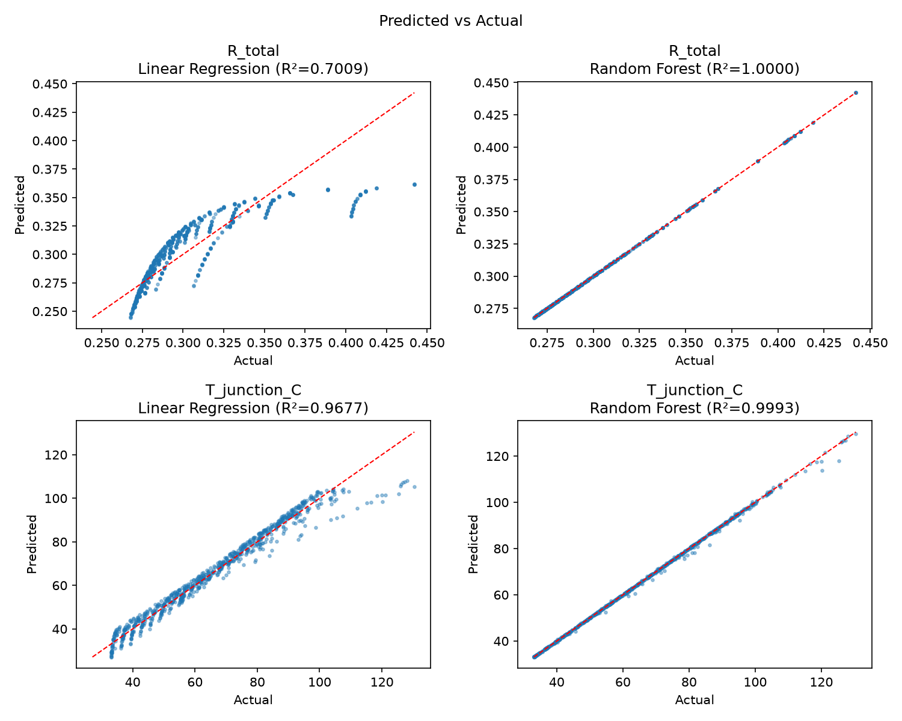
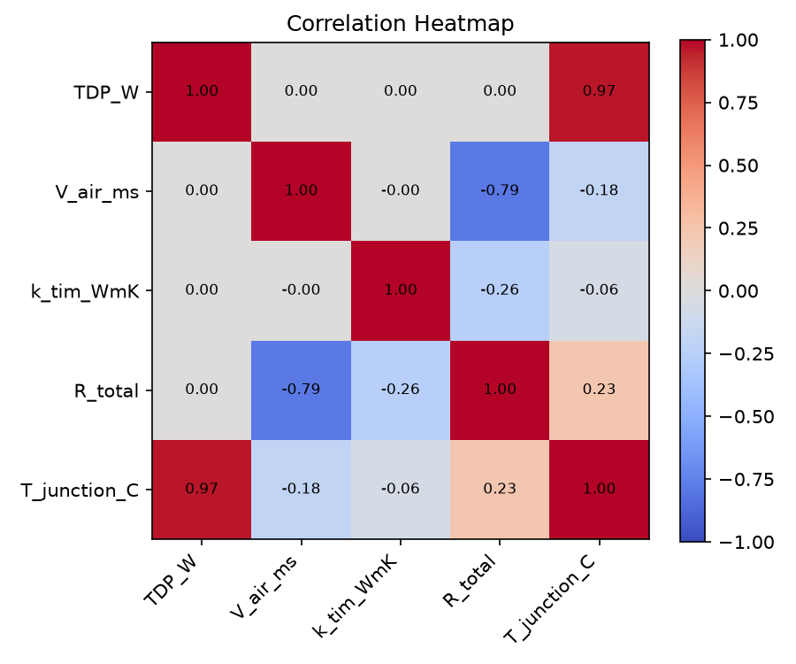
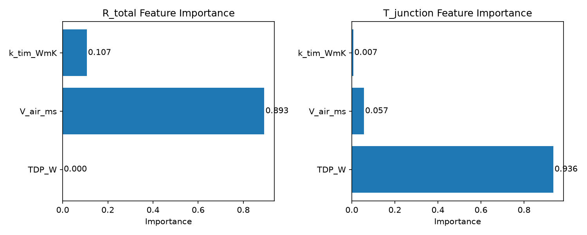

# Physics-Based Heat Sink Thermal Modeling & ML Surrogate Engine

[](https://www.python.org/)
[](#license)
[](https://scikit-learn.org/)

An end-to-end computational thermal engineering framework combining an analytical 1D thermal resistance network with a high-fidelity machine learning surrogate model for high-power electronics and processor heat sinks.

---

## Overview

Designing forced-convection heat sinks for server CPUs or power electronics often requires evaluating thousands of design configurations. While full 3D CFD solves Navier-Stokes equations with high fidelity, running extensive parametric optimization sweeps across velocity, TIM conductivity, and TDP can be computationally prohibitive.

This project delivers:
1. **Analytical Physics Engine:** Computes steady-state convective, conductive, and contact thermal resistances using duct flow correlations (Sieder-Tate / Dittus-Boelter).
2. **Parametric Exploration:** 4,000 simulated operating points across airflow velocities ($0.5 - 15\text{ m/s}$), Thermal Interface Material (TIM) conductivities ($1 - 12\text{ W/m}\cdot\text{K}$), and Thermal Design Powers ($30 - 250\text{ W}$).
3. **ML Surrogate Model:** Fast inference surrogate models (Linear Regression vs. Random Forest Regressor) achieving $R^2 > 0.999$ on junction temperature with sub-millisecond evaluation speed.

---

## Thermal Physics Formulation

The die junction temperature $T_{\text{junction}}$ is computed through a 1D lumped thermal resistance network from processor silicon to ambient air:

$$R_{\text{total}} = R_{\text{jc}} + R_{\text{TIM}} + R_{\text{conv}}$$

$$T_{\text{junction}} = T_{\text{ambient}} + \text{TDP} \cdot R_{\text{total}}$$

### Resistance Elements

1. **Junction-to-Case Resistance ($R_{\text{jc}}$):**
   Fixed internal package resistance ($0.20\,^\circ\text{C/W}$).

2. **Thermal Interface Material ($R_{\text{TIM}}$):**
   $$R_{\text{TIM}} = \frac{t_{\text{TIM}}}{k_{\text{TIM}} \cdot A_{\text{die}}}$$
   - TIM thickness $t_{\text{TIM}} = 0.1\text{ mm}$
   - Die dimensions: $52.5 \times 45\text{ mm}$ ($A_{\text{die}} = 0.0023625\text{ m}^2$)

3. **Convective Heat Sink Resistance ($R_{\text{conv}}$):**
   $$R_{\text{conv}} = \frac{1}{h \cdot A_{\text{total}}}$$
   - Fin Spacing: $s_f = \frac{W - N_{\text{fins}} \cdot t_{\text{fin}}}{N_{\text{fins}} - 1}$
   - Reynolds Number: $\text{Re} = \frac{V_{\text{air}} \cdot s_f}{\nu_{\text{air}}}$
   - Nusselt correlation for developing laminar flow ($\text{Re} < 2300$):
     $$\text{Nu} = 1.86 \left(\text{Re} \cdot \text{Pr} \cdot \frac{2 s_f}{L}\right)^{1/3}$$
   - Convective heat transfer coefficient: $h = \frac{\text{Nu} \cdot k_{\text{air}}}{2 s_f}$
   - Total convective surface area $A_{\text{total}}$ includes fin faces and exposed base floor channels.

---

## ML Surrogate Benchmark Results

A Random Forest Regressor (300 estimators) and baseline Linear Regression were trained on an 80/20 train/test split over the 4,000-point parameter sweep dataset:

| Target Metric | Model | MAE | RMSE | $R^2$ Score |
| :--- | :--- | :---: | :---: | :---: |
| **$R_{\text{total}}\ (^\circ\text{C/W})$** | Linear Regression | $0.0141$ | $0.0194$ | $0.7009$ |
| **$R_{\text{total}}\ (^\circ\text{C/W})$** | **Random Forest** | **$< 10^{-15}$** | **$< 10^{-15}$** | **$1.0000$** |
| **$T_{\text{junction}}\ (^\circ\text{C})$** | Linear Regression | $2.494\,^\circ\text{C}$ | $3.826\,^\circ\text{C}$ | $0.9677$ |
| **$T_{\text{junction}}\ (^\circ\text{C})$** | **Random Forest** | **$0.193\,^\circ\text{C}$** | **$0.558\,^\circ\text{C}$** | **$0.9993$** |

### Key Takeaways
- **Nonlinear Convection:** Linear Regression fails to capture the $h \propto V_{\text{air}}^{1/3}$ power law and $\text{TDP} \times R_{\text{total}}$ coupling, producing an MAE of $2.49^\circ\text{C}$.
- **Surrogate Accuracy:** Random Forest accurately captures boundary-layer scaling and thermal resistance asymptotic saturation, predicting junction temperature within $\pm 0.19^\circ\text{C}$ across the entire operating envelope.

---

## Visualizations

### 1. Predicted vs. Actual
Regression fit across testing data showing model predictions versus physical calculations.



### 2. Feature Importance & Correlations
Sensitivity decomposition showing that airflow velocity dominates total thermal resistance, while TDP drives junction temperature elevation.

| Correlation Heatmap | Feature Importance |
| :---: | :---: |
|  |  |

---

## Repository Structure

```text
Thermal_assignment/
├── heat_sink_parameter_sweep.py    # Analytical physics model & dataset generation (4000 pts)
├── ml_surrogate_model.py           # ML training, evaluation, & plot generation
├── heat_sink_dataset.csv           # Generated parametric sweep dataset
├── model_evaluation_results.csv    # Benchmark metrics (MAE, RMSE, R²)
├── predicted_vs_actual.png         # Parity plots for surrogate validation
├── correlation_heatmap.png         # Parametric correlation matrix
├── feature_importance.png          # Random Forest feature importance chart
├── EXPERT_THERMAL_ASSESSMENT_REPORT.md # Comprehensive engineering & architectural report
└── README.md                       # Project documentation
```

---

## Getting Started

### Prerequisites

Python 3.9+ with standard scientific computing packages:

```bash
pip install numpy pandas matplotlib scikit-learn
```

### Running the Pipeline

1. **Execute Parameter Sweep & Generate Dataset:**
   ```bash
   python heat_sink_parameter_sweep.py
   ```
   Generates `heat_sink_dataset.csv` with 4,000 design evaluations.

2. **Train and Evaluate ML Surrogate Models:**
   ```bash
   python ml_surrogate_model.py
   ```
   Outputs evaluation metrics to `model_evaluation_results.csv` and renders validation figures (`predicted_vs_actual.png`, `correlation_heatmap.png`, `feature_importance.png`).

---

## License

This project is licensed under the MIT License - see the LICENSE file for details.
